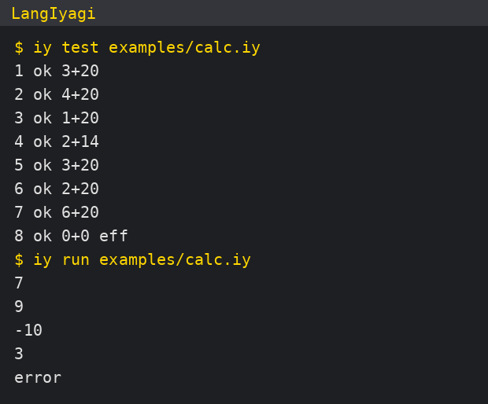

# LangIyagi

A programming language designed to be read and written by AI, using far fewer tokens than C++.

AI가 읽고 쓰도록 만든 프로그래밍 언어. 같은 일을 C++보다 훨씬 적은 토큰으로 씁니다.

- Compact notation with built-in examples and automatic tests
- Interpreter, type checker and C++ code generation in one `iy` command
- Early prototype (0.1)

- 예시와 자동 시험이 들어 있는 간결한 표기
- 해석기·타입 검사·C++ 생성을 `iy` 명령 하나로
- 초기 시제품(0.1)

> Not released yet — downloads will appear under [Releases](../../releases) when it is ready.
> 아직 공개 전입니다. 준비되면 [Releases](../../releases)에 올라옵니다.

